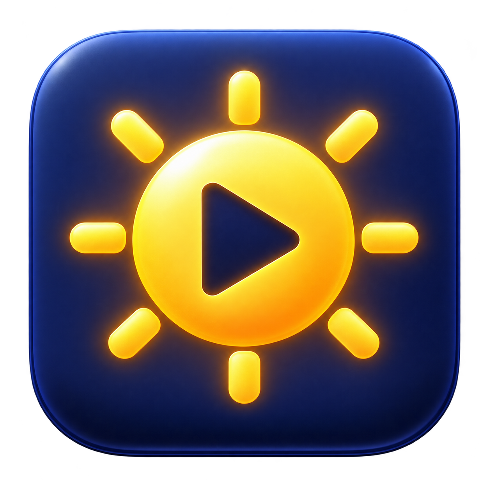

# AutoDisplay

全屏看视频时调亮外接显示器，退出全屏后恢复日常亮度。

这是一份用 Codex 完成显示器适配的开源参考实现。仓库包含原生 Mac 菜单栏工具、浏览器扩展、DDC 探测工具和调查方法，方便你在自己的设备上复现和修改。

**目前只适配并实测了三星 LS27A600U。其他型号请先读[用 Codex 适配自己的显示器](docs/adapting-with-codex.md)，再运行自动化。** 显示器、线缆、转接器、连接方式、输入信号和系统版本都会影响 DDC 行为。

## 能做什么

| 场景 | 当前行为 |
| --- | --- |
| IINA 在目标屏幕上全屏 | 硬件亮度调整为 100 |
| Chrome / Dia 在目标屏幕上全屏显示视频 | 扩展报告视频状态，菜单栏工具调整亮度为 100 |
| 退出全屏、切换到其他应用、关闭自动调整 | 恢复进入观影状态前读取到的亮度 |
| 全屏暂停 | 保持观影亮度 |
| 正常退出工具 | 恢复日常亮度 |
| 强制终止后重新启动 | 根据保存的恢复标记，尝试恢复日常亮度 |

日常亮度初始值为 30；实际恢复值以进入观影前读取的亮度为准。观影亮度 100 目前是代码中的固定值，没有调整它的设置界面。

应用只写 DDC 亮度项 `0x10`，不改变系统 HDR 开关、显示器画面预设、分辨率、刷新率或颜色设置，也不识别片源是否为 HDR。

## 为什么没有自动切换 HDR 预设

最初希望在三星的“个人设定 HDR”和“标准 HDR”之间切换。实测发现两个预设下通用模式码 `0xDC` 都是 2；读写该数值成功，也不能证明实体菜单中的 HDR 预设切换成功。

硬件亮度则可以完成 `30 → 100 → 30` 的写入、读回和恢复。因此最终保留“个人设定 HDR”，只自动调整亮度。这满足了日常低亮度、全屏观影高亮度的需要，但不代表复现了“标准 HDR”的全部画面处理。详见 [DDC 调查与结论](docs/ddc-investigation.md)。

## 适用范围

| 项目 | 范围与限制 |
| --- | --- |
| Mac | Apple Silicon；构建目标为 macOS 13 及以上，未承诺所有系统版本实测兼容 |
| 显示器 | 三星 LS27A600U，厂商编号 `19501`、型号编号 `29044`；这些是型号信息，不是设备序列号 |
| 多屏 | 仅允许一个匹配的目标屏，且仅有一个可控制的外接 DDC 服务；否则拒绝写入 |
| 亮度协议 | 当前实现要求范围为 0–100，并验证写入后的读回值 |
| IINA | 根据前台全屏窗口判断，不读取播放状态 |
| Chrome / Dia | 使用附带的 Manifest V3 扩展，各自配对一次 |
| 全屏判断 | 使用窗口几何信息；某些铺满屏幕的窗口可能被视为全屏 |
| 网页播放器 | 标准视频元素、部分 iframe / 开放 Shadow DOM；自定义播放器可能需适配 |
| 内建屏 / Intel Mac | 当前实现不支持 |

硬件通信使用 macOS 私有 IOAVService 接口，系统升级或连接变化后需要重新验证。当前不会自动开机启动，不提供已公证的安装包，也没有浏览器商店版本。

## 构建与运行

需要 Apple Silicon Mac 和 Xcode Command Line Tools（提供 `swiftc` 等工具）。Node.js 只用于运行浏览器逻辑检查；Python 3 只用于可选的 DDC 调查工具。运行菜单栏应用本身不依赖它们，也不依赖第三方显示器软件。

```sh
git clone https://github.com/AyingAI/autodisplay.git
cd autodisplay
zsh scripts/build.zsh
```

先运行不访问硬件的检查：

```sh
build/AutoDisplay.app/Contents/MacOS/AutoDisplay --self-test
node tests/browser-activity.test.mjs
```

对已适配的显示器，可以先只读确认亮度：

```sh
build/AutoDisplay.app/Contents/MacOS/AutoDisplay --probe-ddc
```

**打开应用会启用自动调整，满足全屏条件时会写入亮度。** 完成硬件验证后再打开：

```sh
open build/AutoDisplay.app
```

菜单栏会出现太阳图标。IINA 不需要插件。需要安装到“应用程序”时，先从太阳菜单退出正在运行的版本，再将 `build/AutoDisplay.app` 拖入“应用程序”，从那里打开。构建使用本机临时签名，未经过 Apple 公证。

### 连接 Chrome / Dia

两个浏览器分别执行一次：

1. 太阳菜单 → **浏览器扩展文件夹**。
2. 在浏览器的扩展管理页开启开发者模式，选择**加载已解压的扩展程序**。
3. 选择含有 `manifest.json` 的 `BrowserExtension` 文件夹，不要选择 `build` 或 `.app` 的顶层目录。
4. 太阳菜单 → **连接 Chrome** 或 **连接 Dia**，在打开的本机页面点击**连接此浏览器**。
5. 刷新此前打开的视频页面，再进入视频全屏。

Chrome 入口为 `chrome://extensions`；Dia 可从设置里的扩展管理入口打开。如果加载了仓库里的扩展，请保留 `BrowserExtension` 的路径；如果加载了应用包内的扩展，请保留应用安装位置。移动或替换扩展后可能需要重新加载、刷新网页。

取消勾选**自动调整亮度**可以暂停；**记住当前日常亮度**可以更新恢复值。

## 用 Codex 适配自己的设备

不要仅替换厂商编号就直接开启自动化。推荐顺序：

1. **识别设备**：确认 Mac、显示器型号、连接方式与 DDC/CI 开关，读取厂商和型号编号。
2. **只读探测**：确认 DDC 可通信、亮度原值与最大值可读。
3. **可恢复写入**：保存原值，经过确认后做一次短暂亮度试验，读回并恢复。
4. **限定目标**：在 `DDC.swift` 中保留明确的目标识别和多屏保护，适配亮度范围及通信时序。
5. **接入自动化**：分别验证全屏、退出、切换应用、暂停、退出工具和重开后的恢复。

[完整适配指南和可直接交给 Codex 的提示词 →](docs/adapting-with-codex.md)

## 结构与隐私

```text
NativeApp/Sources/       菜单栏、DDC、全屏判断、本机浏览器桥接
NativeApp/Resources/     应用图标、图标生成提示词、使用说明
BrowserExtension/       网页视频状态检测与本机配对
tools/                  显示器识别、只读 DDC 探测、可恢复亮度试验
tests/                  浏览器状态选择逻辑检查
scripts/build.zsh       原生应用构建与图标打包
docs/                   适配方法、调查结论、公开内容整理说明
```

不截屏、不录屏，不向云端发送视频、网址、网页文字或标题。扩展需要在 HTTP/HTTPS 页面及子框架运行，以检查视频元素；只向 `127.0.0.1:48741` 发送布尔视频状态。

配对令牌只存于本机应用偏好设置和浏览器扩展存储。本机服务仅绑定回环地址，配对需从菜单发起，并检查扩展来源与安装实例凭据。扩展公钥用于固定扩展 ID，是公开配置，不是认证密钥。

仓库不包含本机运行日志、设备 UUID、配对令牌、个人路径、编译缓存和已签名应用。检查自己的报告后再分享；详见[公开范围与整理记录](docs/open-source-scope.md)。

## 验证与贡献

初始适配中，LS27A600U 的亮度写入和恢复已实测，Chrome、Dia、IINA 全屏流程均由使用者确认有效。原生逻辑和协议检查 16 项、浏览器状态检查 10 项通过。这些检查不替代其他显示器上的硬件验证。

欢迎提交兼容性记录：Mac 架构、macOS 版本、显示器型号、线缆/转接器、HDR 状态、亮度可读/可写/可恢复的结果。请省略设备序列号、UUID、浏览记录和连接凭据。

## 许可与参考

[MIT License](LICENSE)。应用图标由 OpenAI image_gen 生成，源图和生成提示词随仓库提供。

IOAVService 接口和传输方式参考 [AppleSiliconDDC](https://github.com/waydabber/AppleSiliconDDC) 与 [m1ddc](https://github.com/waydabber/m1ddc)。仓库未打包它们的库或二进制；致谢见 [NOTICE](NOTICE)。本项目与 Apple、Samsung、IINA 及相关浏览器无隶属关系。
